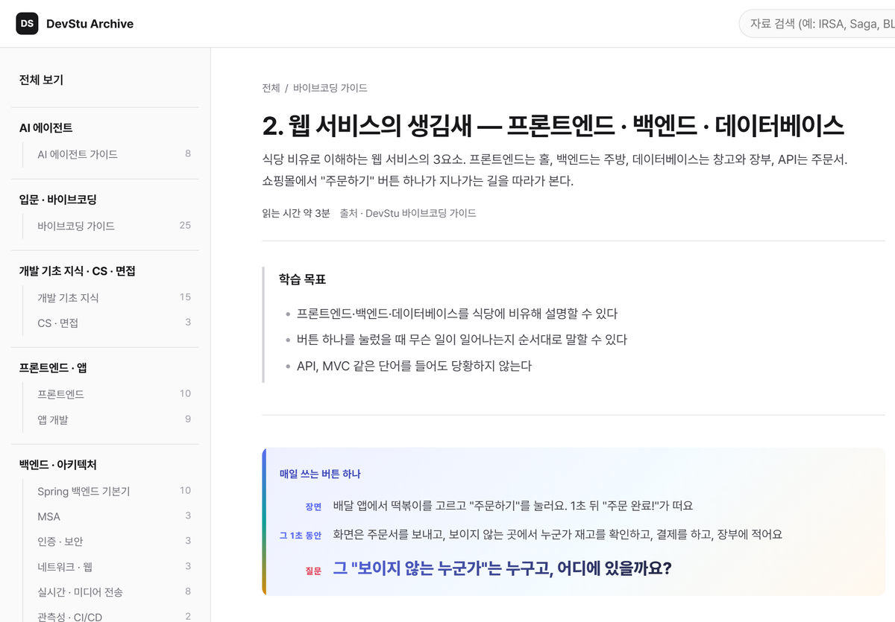

# 안녕하세요, 백엔드 개발자 구지훈입니다 👋

### "Why"와 "How"를 끊임없이 생각하는 개발자

AI가 코드를 쓰는 시간이 늘수록 구조를 이해하고 설계하는 능력이 중요하다고 봅니다. 
AI 없이도, AI와 함께라도 제 몫을 해내는 백엔드 개발자를 목표로 합니다.

 

 

## 💭 개발 회고 중에서

> **AI와 일할 때 스스로 묻는 세 가지**
>
> 1. AI 없이도 이것을 구현할 수 있는가?
> 2. AI 없이 나는 어디까지 할 수 있는가?
> 3. AI가 주어진다면 어디까지 해낼 수 있는가?

AI가 많은 일을 대신할수록 설계하고, 검증하고, 책임지는 사람이 더 필요하다고 봅니다. 
그래서 AI에게는 하지 말아야 할 것과 참고할 문서, 지킬 기준을 먼저 정해 준 뒤 맡깁니다.

 

## 🙋 About Me

| 강점 | 내용 |
|---|---|
| 🔍 **왜를 먼저 묻습니다** | 마케팅 기획 때도 타겟이 왜 반응할지부터 따졌습니다. 개발에서는 그 답을 측정과 근거로 확인하고, 기술도 대안과 비교해 고릅니다. |
| 🧭 **팀이 끝까지 완주하게** | 두 번의 팀 프로젝트 모두 팀장을 맡았습니다. 문서와 컨벤션으로 기준을 먼저 세우고, 모두가 맡은 기능을 끝까지 완성하게 이끌었습니다. |
| 📝 **기록을 다음 판단의 근거로** | 회의록, 결정 로그, 트러블슈팅 90건으로 남기고, 새 방식이 나오면 기록과 비교해 더 나은 쪽을 고릅니다. |

- 🌱 청년취업사관학교 새싹(SeSAC) 영등포캠퍼스 8기 최우수팀 수료, 최종 프로젝트 곳간으로 우수 프로젝트상 수상

 

## 📚 How I Study: DevStu Archive `운영 중`

> **배운 것은 다른 사람에게 설명할 수 있을 때까지 정리합니다.**

수업 자료, 노션 정리, 프로젝트 트러블슈팅을 주제별로 다시 묶어 직접 만들고 운영하는 학습 사이트입니다. 
AI 에이전트, 백엔드, 인프라, 프론트, 앱, CS까지 **공개 문서 165개, 주제 섹션 20개, 도식과 흐름도 850개 이상**.

| 단계 | 하는 일 |
|---|---|
| **1. 모은다** | 수업 자료, 노션 정리, 프로젝트 기록을 한곳에. 곳간 트러블슈팅 90건을 주제별 사례로 재구성 |
| **2. 다시 쓴다** | 외운 문장이 아니라 구조로: 흐름도, 계층도, 비교표. 장마다 "꼭 짚고 넘어갈 것"으로 마무리 |
| **3. 설명한다** | 개발을 모르는 사람용 바이브코딩 가이드 25장, 면접 질문은 "정의 → 이유 → 경험 → 한계"로 정리 |
| **4. 검증한다** | AI와 함께 만들되 테스트 237개로 확인, 전 문서 렌더링과 도식 정렬을 PC와 모바일에서 전수 검사 |

  
   
  바이브코딩 가이드 2장: 개발을 모르는 사람도 따라오도록 장면, 비유, 흐름도로 설명

  

`React` `Vite` `TypeScript` `Firebase` `Vercel` `Claude Code`

 

## 💪 해 본 것

| 역량 | 내용 | 어디서 |
|---|---|---|
| **클라우드 인프라** | Terraform으로 VPC, EKS, SNS/SQS, Lambda 구성 클러스터를 매일 자동으로 만들고 지움 | 곳간 |
| **분산 환경의 정합성** | 아웃박스, 멱등, 발생 시각 비교로 이벤트 정합성 결제 취소는 선기록 후 호출, 모르면 조회로 대조 | 곳간 |
| **측정 기반 개선** | k6로 동시성 문제 7건 발견 → 수정 → 재측정 채팅 왕복 p95 1.95s → 87ms | 곳간 |
| **운영 화면** | 관리자 화면에서 부하테스트(k6 Job, 사용자 수 슬라이더) 실시간 모니터링 5개 탭과 트레이스 | 곳간 |
| **동시성 제어** | Redis Lua Script로 입찰 조회, 검증, 갱신을 한 번에 Redis 예외 시 DB 락으로 전환 후 복귀 | Fantry |
| **인증과 보안** | AT는 메모리, RT는 HttpOnly 쿠키 + Redis jti 블랙리스트와 회원 단위 마커로 즉시 차단 | Ddasoom |

 

## 🚀 Projects

### 🏆 곳간 (GOTGAN): MSA 멀티 스토어 오픈마켓 `2026.10 – 2026.11`
> 팀장, AWS 인프라와 결제, 정산, 관리자, 채팅 담당 (3인, SeSAC 최종 프로젝트, 우수 프로젝트상)

- Spring Boot 마이크로서비스 10개를 Terraform으로 만든 AWS EKS에 배포
- 돈이 걸린 흐름은 "모든 단계가 실패할 수 있다"를 전제로 설계
- k6 부하테스트로 측정 → 수정 → 재측정, 관리자 화면에 부하테스트와 실시간 모니터링 구현
- 가이드 문서와 목업을 직접 만들어 팀의 기준으로, AI 작업 규칙과 문서를 컨텍스트로 구현하고 테스트와 리뷰로 검증
- 머지된 PR 525개(내 PR 275개), 테스트 2,278개, 트러블슈팅 기록 90건

 

`Java 21` `Spring Boot 4.1` `Spring Cloud Gateway` `Resilience4j` `MySQL` `Redis` `Keycloak` `AWS EKS` `Lambda` `SNS/SQS` `Terraform` `Argo CD` `k6`

> **회고**: 설계에 공들인 만큼 단단해졌고, 유연하게 바꾸는 힘도 그만큼 중요했던 6주

---

### 🔨 Fantry: 실시간 중고 경매 플랫폼 `2025.09 – 2025.10`
> 실시간 경매 시스템 총괄 (Full Stack 5인)

- WebSocket(STOMP) 실시간 입찰
- Redis Lua Script로 조회, 검증, 갱신을 한 번에 처리
- Redis 예외 시 DB 비관적 락으로 전환, 재동기화에 성공하면 복귀
- 입찰 기록은 큐에 모아 2초마다 저장

`Java 21` `Spring Boot` `JPA` `MySQL` `Redis` `Lua Script` `WebSocket` `Vue 3`

---

### 🐾 Ddasoom (따숨): 유기동물 임시보호 플랫폼 `2026.06 – 2026.07`
> 팀장, 회원과 보안, 공통 모듈 담당 (5인, SeSAC 미니 프로젝트)

- 토큰 저장 위치와 제재 회원 즉시 차단을 선택지, 근거와 함께 결정 로그로 남김
- Spring Security 인증 인프라 직접 설계
- 팀 공통 규격(응답, 예외, 페이징)과 컨벤션 문서 작성

`Java 21` `Spring Boot 3.5` `Spring Security` `JWT` `OAuth2` `QueryDSL` `MySQL` `Redis` `React 19`

---

### 🛍️ intelliMarket: 스마트스토어 모티브 쇼핑몰 `2025.07 – 2025.08`
> 스토어 어드민 상품과 주문 관리, 카테고리 구조 설계 (4인, 첫 팀 프로젝트)

- 루트, 탑, 서브 3단계 카테고리와 스토어 N:M 매핑 설계
- 카테고리 트리 조회의 N+1을 4-테이블 JOIN과 중첩 resultMap으로 개선

`Java 8` `Spring MVC (Legacy)` `MyBatis` `MySQL` `JSP`

 

## 🛠️ Tech Stack

**Backend, MSA**

**Database, Messaging**

**Cloud, DevOps**

-232F3E?style=flat-square&logo=amazonwebservices&logoColor=white)

**Observability, Test**

**Frontend, Tools**

 

## 📜 Education & Certificates

| 구분 | 내용 | 시기 |
|---|---|---|
| 교육 | 청년취업사관학교 새싹(SeSAC) 영등포캠퍼스 8기, MSA 기반 웹 서비스 개발, **최우수팀 수료, 우수 프로젝트상** 🏅 | 2026.05 – 2026.11 |
| 교육 | Java 기반 백엔드 개발자 양성 과정, **최우수 팀 수료** 🏅 | 2025.04 – 2025.10 |
| 경력 | (주)플라잉에그 매니저, SK가스 마케팅 대행과 스마트스토어 운영 | 2020.08 – 2024.12 |
| 자격증 | SQLD (SQL 개발자) | 2026.06 |
| 자격증 | JLPT N1 | 2019.08 |

 

## 📌 더 깊게 보고 싶다면

**설계 결정, 트러블슈팅, 부하테스트 수치, 회고까지 프로젝트별로 정리했습니다.**

### 👉 [웹 포트폴리오 방문하기](https://portfolio-jihoon-dev.vercel.app/) 👈

